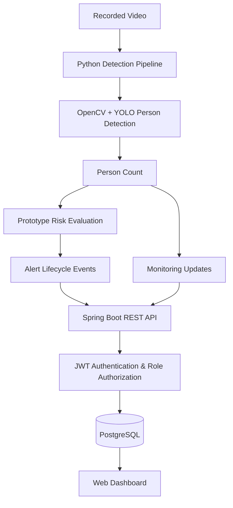

::: {align="center"}
```{=html}
<!-- Animated heading: rendered by the readme-typing-svg service -->
```
`<a href="https://github.com/yashdamare1/Nexa-Crowd-Monitoring">`{=html}
``{=html}
`</a>`{=html}

```{=html}
<p>
```
`<strong>`{=html}An academic prototype for video-based person detection,
crowd-level monitoring, and alert generation.`</strong>`{=html}
```{=html}
</p>
```
```{=html}
<p>
```
``{=html}
``{=html}
``{=html}
``{=html}
``{=html}
```{=html}
</p>
```
```{=html}
<p>
```
`<a href="#overview">`{=html}Overview`</a>`{=html} •
`<a href="#features">`{=html}Features`</a>`{=html} •
`<a href="#architecture">`{=html}Architecture`</a>`{=html} •
`<a href="#getting-started">`{=html}Getting Started`</a>`{=html} •
`<a href="#api-reference">`{=html}API`</a>`{=html} •
`<a href="#limitations">`{=html}Limitations`</a>`{=html}
```{=html}
</p>
```
:::

------------------------------------------------------------------------

> **Project scope:** Nexa is an academic prototype that processes
> recorded video and demonstrates person detection, count-based
> crowd-level classification, monitoring history, and alert events. Its
> thresholds are configurable demonstration rules---not validated
> public-safety limits. Nexa does **not** claim to predict or prevent
> stampedes.

## Overview

Nexa combines a Python computer-vision pipeline with a Java Spring Boot
backend and a browser-based dashboard. The pipeline analyses recorded
video, detects people, estimates the visible person count, evaluates a
prototype risk category, and sends monitoring updates and alert events
to the backend. The backend persists monitoring and alert information in
PostgreSQL for display on the dashboard.

## Features

```{=html}
<table>
```
```{=html}
<tr>
```
```{=html}
<td width="50%" valign="top">
```
### AI video analysis

-   Person detection using an Ultralytics YOLO model
-   Video processing with OpenCV
-   Person-count estimation per frame
-   Configurable crowd-level evaluation

```{=html}
</td>
```
```{=html}
<td width="50%" valign="top">
```
### Backend and monitoring

-   Spring Boot REST API
-   JWT authentication
-   `ADMIN` and `SECURITY` roles
-   Monitoring source state and sample history
-   Alert creation and resolution history

```{=html}
</td>
```
```{=html}
</tr>
```
```{=html}
<tr>
```
```{=html}
<td width="50%" valign="top">
```
### Web dashboard

-   Monitoring source overview
-   People-count history chart
-   Risk category display
-   Alert history
-   Video selection and monitoring controls

```{=html}
</td>
```
```{=html}
<td width="50%" valign="top">
```
### Data and persistence

-   PostgreSQL database
-   Latest monitoring state
-   Historical monitoring samples
-   Persisted alert events
-   Protected API endpoints

```{=html}
</td>
```
```{=html}
</tr>
```
```{=html}
</table>
```
## Technology Stack

  Layer                  Technologies
  ---------------------- -----------------------------------------------------
  Backend                Java, Spring Boot, Spring Security, Spring Data JPA
  Authentication         JWT, BCrypt password hashing
  Database               PostgreSQL
  AI / Computer vision   Python, OpenCV, Ultralytics YOLO
  Frontend               HTML, CSS, JavaScript
  Build                  Maven Wrapper
  Application server     Embedded Apache Tomcat

## Architecture



## Project Structure

``` text
nexa/
├── ai/
│   ├── detection/          # Detection, alert, and backend integration scripts
│   ├── video/              # Local test videos (not committed)
│   └── .venv/              # Python virtual environment (not committed)
├── launcher/
│   └── Start-Nexa.ps1      # Windows launcher
├── src/
│   └── main/
│       ├── java/           # Spring Boot application source
│       └── resources/
│           └── static/     # Login page, dashboard, CSS, and JavaScript
├── mvnw
├── mvnw.cmd
└── pom.xml
```

## Getting Started

### Prerequisites

-   Windows 10 or Windows 11
-   Java Development Kit compatible with the project (development
    environment: Java 25)
-   PostgreSQL (development environment: PostgreSQL 18)
-   Python 3
-   Git

Maven Wrapper scripts are included, so a separate Maven installation is
not required.

### 1. Clone the repository

``` powershell
git clone https://github.com/yashdamare1/Nexa-Crowd-Monitoring.git
cd Nexa-Crowd-Monitoring
```

### 2. Configure PostgreSQL and application secrets

1.  Create a PostgreSQL database named `nexa`, unless you use a
    different name in your local configuration.
2.  Configure the datasource URL, database username, and password in
    your local application configuration.
3.  Configure the JWT signing secret using a secure local configuration
    method.
4.  Never commit real credentials, signing keys, access tokens, or
    private configuration files.

**Security note:** If a credential was committed to Git at any point,
deleting it from the latest version is not sufficient. Rotate the
credential and remove the exposed value from repository history before
making the repository public.

### 3. Start the backend

Run from the project root:

``` powershell
.\mvnw.cmd spring-boot:run
```

The current development setup uses port `8081`.

  Page        URL
  ----------- --------------------------------------
  Login       http://localhost:8081/login.html
  Dashboard   http://localhost:8081/dashboard.html

If port `8081` is already in use, stop the process using it or change
the server-port configuration.

### 4. Prepare the Python environment

Create a virtual environment if one does not already exist:

``` powershell
py -m venv .\ai\.venv
.\ai\.venv\Scripts\Activate.ps1
```

Install the Python dependencies required by the detection scripts. If a
dependency file is present in the repository, install from that file;
otherwise follow the dependencies specified by the source code.

### 5. Run the video pipeline

Set the credentials for a Nexa account in the current PowerShell
session:

``` powershell
$env:NEXA_EMAIL="your-account-email"
$env:NEXA_PASSWORD="your-account-password"
```

Run the pipeline using a video file that exists in `ai\video`:

``` powershell
.\ai\.venv\Scripts\python.exe .\ai\detection\video_alert_test.py ".\ai\video\sample.mp4"
```

-   Press `q` in the OpenCV video window to close its display.
-   If the pipeline was started from the dashboard, also use the
    dashboard's **Stop Monitoring** control.
-   Dashboard-supported video extensions: `.mp4`, `.avi`, `.mov`, and
    `.mkv`.

## Prototype Risk Rules

The current implementation uses these count-based categories:

  Category       Person count
  ------------ --------------
  `NORMAL`              0--19
  `WARNING`            20--39
  `CRITICAL`       40 or more

Persistence settings currently used:

  Setting                                    Value
  ------------------------ -----------------------
  Escalation persistence     15 consecutive frames
  Recovery persistence       90 consecutive frames

These values are prototype configuration settings for demonstration and
testing. They are not scientifically validated crowd-safety thresholds
and must not be used to make real-world emergency decisions.

## API Reference

The backend exposes the following monitoring and video-control
endpoints:

  -------------------------------------------------------------------------------------------------------
  Method                  Endpoint                                                Purpose
  ----------------------- ------------------------------------------------------- -----------------------
  `POST`                  `/api/security/monitoring/updates`                      Receive monitoring
                                                                                  updates

  `GET`                   `/api/security/monitoring/sources`                      List monitoring sources

  `GET`                   `/api/security/monitoring/sources/{sourceId}`           Retrieve the latest
                                                                                  state for a source

  `GET`                   `/api/security/monitoring/sources/{sourceId}/history`   Retrieve recent
                                                                                  monitoring samples

  `GET`                   `/api/security/video/videos`                            List available video
                                                                                  files

  `POST`                  `/api/security/video/start`                             Start video monitoring

  `POST`                  `/api/security/video/stop`                              Stop video monitoring

  `GET`                   `/api/security/video/status`                            Check video-process
                                                                                  status
  -------------------------------------------------------------------------------------------------------

Protected endpoints require a valid JWT and the appropriate role.

## Build and Test

Compile the project:

``` powershell
.\mvnw.cmd clean compile
```

Run the automated test suite:

``` powershell
.\mvnw.cmd test
```

Create a package without running tests:

``` powershell
.\mvnw.cmd clean package -DskipTests
```

The `-DskipTests` option skips test execution. A successful package
build alone does not establish that the automated tests pass.

## Screenshots and Demo

Screenshots and a short demonstration GIF can make the repository easier
to evaluate. Add genuine captures from your running application in a
folder such as `docs/images/`, then embed them here.

Suggested captures:

-   Dashboard overview
-   Video monitoring panel
-   Person detection window
-   Alert history and risk timeline

Example Markdown once you have added a screenshot:

``` markdown

```

Do not use placeholder screenshots as evidence of implemented
functionality.

## Limitations

-   The current pipeline processes recorded video; it is not a complete
    live-CCTV deployment.
-   Risk categories are based on person counts and configurable
    persistence rules.
-   The system does not perform validated stampede prediction.
-   It does not provide crowd-flow analysis, evacuation guidance, or
    certified emergency notifications.
-   Video-process management is tied to the running backend instance;
    production-grade multi-instance process management is outside the
    current prototype scope.

## Future Scope

Potential extensions include:

-   Live camera integration
-   Improved crowd-density estimation
-   Movement and crowd-flow analysis
-   Site-specific configurable policies
-   More detailed audit and reporting
-   Deployment monitoring and operational hardening
-   Evaluation against appropriately labelled datasets

Any safety-related capability would require domain-expert review and
rigorous validation before operational use.

## Contributors

Add the project contributors and their responsibilities here.

## Academic Disclaimer

Nexa is developed as an academic prototype to demonstrate the
integration of computer vision, backend services, database persistence,
authentication, and a web dashboard. It is not a certified
crowd-control, surveillance, or emergency-management product.

------------------------------------------------------------------------

::: {align="center"}
**Nexa --- From Video Detection to Monitoring and Alerts**

`<sub>`{=html}Built as an academic software engineering
project.`</sub>`{=html}
:::
